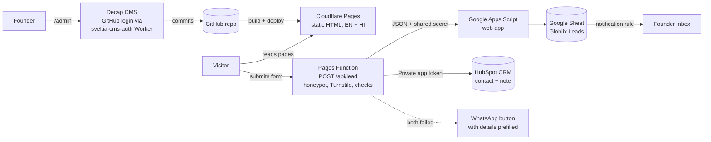

# globlix.in website architecture

Version 2.0, October 2026. Hosting: Cloudflare Pages. Languages: English and Hindi. Lead storage: Google Sheets and HubSpot free CRM.

## 1. Goals

1. Turn visitors (manufacturers, artisans and stuck exporters) into leads through three forms: a 4-field **Quick enquiry** (home hero and every service page), the detailed **Free HSN snapshot**, and **Contact**.
2. Save every lead in two places: a Google Sheet (team follow-up, email alert) and HubSpot (long-term contact history and emails). If both fail, the visitor is offered WhatsApp with the details prefilled.
3. Let the founder edit pages and publish articles from a browser, without code.
4. Serve English at `/` and Hindi at `/hi/`, with correct SEO signals for both.
5. Run on Cloudflare's free plan, with no paid plugins.

## 2. System overview

## 3. Technology choices

| Layer | Choice | Why |
|---|---|---|
| Site generator | Small Node build script (`scripts/build.mjs`), no npm dependencies | Fast, nothing to update or break; Cloudflare runs it with plain Node 22 |
| Hosting | Cloudflare Pages | Free HTTPS and global CDN with unlimited bandwidth; DNS, redirects and spam protection in the same account |
| Editor | Decap CMS at `/admin`, GitHub backend, login through the free `sveltia-cms-auth` Worker | Edit pages and blog in the browser; content stays in GitHub |
| Forms | Plain HTML forms posting to a Pages Function (`functions/api/lead.js`) | Free (100,000 function requests a day); works with and without JavaScript |
| Spam | Honeypot field, server-side required-field checks, optional Cloudflare Turnstile | Turnstile is free and has no picture puzzles for most visitors |
| Sheet | Google Apps Script web app writing to Google Sheets | Free, no Google Cloud project or service account needed |
| CRM | HubSpot free CRM through a private app token | Contact upsert by email plus a timeline note with all form details |
| Fonts | Sora, IBM Plex Sans, Noto Sans Devanagari (Google Fonts) | Brand look, proper Hindi rendering |

## 4. Sitemap

Every page exists at `/path/` (English) and `/hi/path/` (Hindi).

| Page | Path | Purpose |
|---|---|---|
| Home | `/` | Conversion page: hero with quick enquiry form, trust bar, each pain point mapped to the service that solves it, proof numbers, 4-step process, who it's for, duty-free markets, FAQ, final call to action |
| Services | `/services/` | Overview of the five pillars |
| Service pages | `/services/setup-compliance/`, `strategic-intelligence/`, `aggregator-engine/`, `financial-growth/`, `digital-launchpad/` | One page per pillar |
| Markets | `/markets/` | USA, EU, UK, Middle East and new trade-deal markets, with sources |
| Schemes | `/schemes/` | RoDTEP, RoSCTL, Export Promotion Mission and how Globlix helps |
| Insights | `/insights/` and `/insights/<slug>/` | Blog: market research and guides |
| About | `/about/` | Story, QOPTUM backing since 2017, working principles |
| Free HSN snapshot | `/free-hsn-snapshot/` | Main lead form |
| Contact | `/contact/` | Short contact form, email, phone, WhatsApp |
| Thank you | `/thank-you/` | After a form is sent (not indexed) |
| Privacy, Terms | `/privacy/`, `/terms/` | Legal pages (drafts for lawyer review) |
| Editor | `/admin/` | Decap CMS (not indexed) |

A floating **WhatsApp** button on every page opens `wa.me/<number>` with a greeting in the visitor's language.

## 5. Lead pipeline

### Forms and fields

Quick enquiry (`quick-enquiry`): name, email, phone/WhatsApp, product, consent, plus the hidden fields below.

| Field | Contact | HSN snapshot | Notes |
|---|---|---|---|
| name, email, phone | required | required | phone accepts +, spaces, brackets |
| company | optional | optional | |
| location | | optional | city and state |
| product | | required | |
| hsn_code | | optional | 4, 6 or 8 digits; hint says "leave blank if unsure" |
| export_status | | required | new / growing / stuck |
| target_markets | | optional | multi-select, joined as "USA, Japan" |
| monthly_capacity | | optional | free text |
| message | required | optional | |
| consent | required | required | consent to store and contact, links to the privacy policy |
| lang, page, utm_source, utm_medium, utm_campaign | hidden | hidden | language, page and campaign tags for reporting |
| bot-field | hidden | hidden | honeypot: bots fill it, people never see it |

Field names are the same on the English and Hindi pages; values for markets are always stored in English so the sheet stays sortable.

### Flow

1. The browser posts the form to `/api/lead` (AJAX with `Accept: application/json`; without JavaScript a normal POST that is answered with a redirect to the thank-you page in the visitor's language).
2. The Pages Function (`lib/leads.mjs > handleLead`) quietly accepts and discards honeypot entries, checks the Turnstile token when `TURNSTILE_SECRET` is set, rejects unknown form names and missing required fields, and gives the lead an ID.
3. It normalises the data once and then, in parallel:
   - **Google Sheets:** posts the row with a shared secret to the Apps Script web app. The script appends it to a tab named after the form (`contact`, `hsn-snapshot`), adds new columns automatically, and blocks spreadsheet formula injection. A `follow_up_status` column starts as "New" for the team to update.
   - **HubSpot:** creates or updates the contact by email (`/crm/v3/objects/contacts/batch/upsert`), then adds a **note** on the contact's timeline with every form field (`/crm/v3/objects/notes`, association type 202). No custom HubSpot properties need to be created.
4. If one destination fails, the other still receives the lead and the error is written to the function log (Pages > Functions > Real-time logs). If neither stored it, the function answers 502 and the visitor sees the error with a **Send these details on WhatsApp** button.
5. A Google Sheets notification rule emails the founder for each new row.

### Secrets (Cloudflare Pages > Settings > Variables and Secrets)

| Variable | Used for |
|---|---|
| `SHEETS_WEBHOOK_URL` | Apps Script web app URL |
| `SHEETS_SECRET` | Shared secret also stored in the Apps Script's script properties |
| `HUBSPOT_TOKEN` | HubSpot private app token with `crm.objects.contacts.read` and `crm.objects.contacts.write` |
| `TURNSTILE_SECRET` | Optional Turnstile secret key; set together with the site key in Site settings |

Secrets never appear in the code or in the browser.

## 6. Content model (what you can edit in /admin)

| Collection | Files | Fields |
|---|---|---|
| Insights (blog) | `content/blog/en/*.md`, `content/blog/hi/*.md` | title, date, description, tags, cover image, draft, article |
| Services (5 pillars) | `content/services/<lang>/*.md` | title, summary, order, icon, page text |
| Pages | `content/pages/<lang>/*.md` | about, markets, schemes, privacy, terms |
| Home page | `content/home/en.json`, `hi.json` | every text block on the home page |
| Market access board | `content/markets/en.json`, `hi.json` | each market's duty status (0% now, coming, cuts, normal, extra), note, and the trade-deal timeline |
| Site settings | `content/settings.json` | email, phone, WhatsApp number and greetings, address, social links |

### Visual building blocks
- Home: "Why now" big-number facts with sources, problem-to-solution infographic (one row per pillar), four-step journey flow, duty-free market board.
- Markets: colour-and-icon status board (status is always written in words, not colour alone) and a trade-deal timeline.
- Any article or page: `chart` (bar chart with a highlighted row and a hidden data table for screen readers), `stats` (big-number tiles) and `steps` (numbered flow) blocks typed in the editor.

Interface labels (menu, form labels, buttons) are in `src/i18n/en.json` and `hi.json` and change rarely; a developer edits those.

Hindi articles share the English article's URL slug. If a Hindi version is missing, that article is simply not listed on the Hindi site.

## 7. SEO

- One `<h1>` per page, meta description, canonical URL, Open Graph image.
- `hreflang` links between English and Hindi versions plus `x-default`.
- `sitemap.xml` with language alternates; `robots.txt` blocks `/admin/` and thank-you pages.
- JSON-LD: ProfessionalService (business, contact, languages, service catalogue, alternate name "Globlix Exim Solutions", Google Business Profile link), WebSite and FAQPage on the home page; Service on each service page; Article with published and updated dates on each post; AboutPage; BreadcrumbList on inner pages, with visible breadcrumbs.
- `llms.txt` at the site root: a plain summary of Globlix, its services, pricing model, markets and contact details for AI assistants (ChatGPT, Perplexity, Gemini, Claude).
- Fonts load without blocking the page; English pages skip the Devanagari font.
- Founder block on the About page (and author in article data) appears once founder details are filled in Site settings.
- Static HTML and fingerprinted CSS/JS cached for a year, so pages load quickly on mobile networks.

## 8. Security and privacy

- Spam: honeypot field, server-side validation of form name and required fields, and optional Cloudflare Turnstile verified on the server.
- The function accepts only the three known forms, ignores file uploads and caps every field at 2,000 characters.
- The Apps Script rejects requests without the shared secret and neutralises cells starting with `= + - @`.
- Security headers in `static/_headers`: HSTS, no-sniff, referrer policy, frame protection, permissions policy; `/admin` is marked noindex.
- India's DPDP Act 2023: explicit consent checkbox on every form and a privacy policy draft naming where data is stored (Cloudflare, Google, HubSpot). **Have a lawyer finalise the privacy policy and terms before launch.**
- Editor access: only GitHub accounts with write access to the repository can sign in; the login Worker only serves `globlix.in` (`ALLOWED_DOMAINS`).

## 9. Cloudflare free plan budget

| Item | Free allowance | Globlix use |
|---|---|---|
| Static pages and bandwidth | Unlimited | All page views |
| Builds | 500 a month | One per publish, plus one per draft preview |
| Pages Functions (Workers) | 100,000 requests a day | One per form submission |
| Turnstile | Free | Optional spam check |

There is no monthly credit cap to watch. Images should still be resized before upload (aim for under 300 KB each) so pages load quickly on mobile networks.

## 10. Future additions

- Analytics (for example Plausible or Google Analytics 4 with a consent banner).
- HubSpot custom properties (HSN code, target markets) for filtering, once the lead volume justifies it.
- Automated WhatsApp follow-up through the WhatsApp Business API.
- Academy course pages and paid bookings.
- More languages (for example Gujarati or Tamil) by adding a locale folder.
